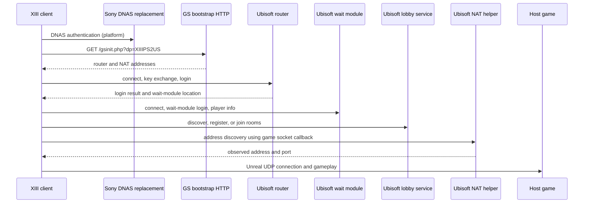

# XIII PS2 online workflow and server design

This analysis covers the US disc identified by the hashes in [the original notes](xiii-ps2-network.md). The unmodified client has now created an account, authenticated, reached the lobby, apparently refreshed an empty list, registered a host and loaded a match against the experimental service. Subsequent LAN tests verified discovery, joining, and two-player combat; the newer implementation status is recorded in the protocol map. Historical static observations below retain their original uncertainty labels. The deeper field-level map and its remaining unknowns are in [network protocol research](xiii-network-protocol.md). Addresses without another label are EE virtual addresses. `NET_M.OVL` is analyzed as a raw image loaded at `0x01cee500`; its calls into the main ELF are unresolved in the standalone project, and some Ghidra types and boundaries are guesses. The projects and extraction are local under `work/ghidra-analyzed` and `work/disc`.

**Evidence labels:** client = followed in XIII code; library = present in XIII's linked SDK but not necessarily exercised; comparison = another game's independently developed emulator; hypothesis = an interpretation that needs runtime evidence. A Ghidra result is not a packet capture.

## Overview



The arrows show the service roles established by the code and the probable high-level order. Exact sequencing and which lobby connection uses which endpoint must be checked live. The host has the same platform, bootstrap and lobby stages as a joiner. Whether NAT discovery occurs and succeeds depends on the branch and configured NAT service; the client has failure/fallback paths. Do not assume this diagram proves peer hole punching or the existence of a gameplay relay.

## Platform setup and DNAS

* The game exposes network configuration, network control, and DNAS operations to its Unreal script layer. The main ELF logs DNAS initialization and loads `OVL/DNAS_M.OVL`; the disc also contains `IRX/DNAS280.IMG`. The DNAS overlay identifies a US 2.80-era DNAS build. The main wrapper at `0x0039ed30` starts authentication through overlay function `0x01bdeca0`; `0x0039ed80` reads its status. The exact scripted ordering and success status require an execution trace.
* The local test used the existing TSFP DNAS store. XIII's two observed US requests matched stored records, and the game advanced to Ubisoft account creation. This establishes the observed local path, not coverage of every region or disc revision.
* DNS should direct the DNAS name actually requested by this disc and `gsconnect.ubisoft.com` to the local lab. DNS, DNAS, and Ubisoft are separate services even if one machine hosts them all. Record the hostname and whether DNAS reaches a successful client status before diagnosing Ubisoft.

## Bootstrap and product selection

The setup routine at `0x0037be30` assigns three static globals: `XIIIPS2US`, `XIIIPS21.0`, and `1.0`. The first is passed by `0x0037e500` / `0x0039f960` into `0x0039f2c0`, which resolves `gsconnect.ubisoft.com`, connects to TCP port 80, and sends:

```http
GET /gsinit.php?dp=XIIIPS2US HTTP/1.1
HOST: gsconnect.ubisoft.com

```

The request actually uses CRLF. The code reads into a 1,460-byte zeroed receive buffer until the connection closes, then searches the *entire response* for indexed keys. A router entry needs all of `routeripN`, `routerportN`, and `routerlauncherportN`; NAT needs `natserveripN` and `natserverportN`. The parser at `0x0039f210` searches for a key substring, advances to `=`, and copies through the next CR or LF. It starts at index zero. Keep responses short, terminate every value with a newline, and close the connection. Present consecutive entries starting with zero; the behavior with a present index 11 and entries after it has not been established. The client saves values under `Engine.MatchMakingServers` and later attempts router entries. `0x0037e500` reads the first NAT address and port for NAT initialization.

The experimental Apache [bootstrap responder](../deploy/gsinit.php) was consumed by XIII and selects the US product ID. Its advertised router and launcher ports are both exercised by the client: the launcher is reached during game registration. The Python responder currently accepts any `dp`; a general service should select an explicit profile and reject unknown profiles. [Another Ubisoft emulator's bootstrap](https://github.com/michal-kapala/ubi-gs/blob/master/gsconnect/gsconnect.py) also dispatches configurations by `dp`, including a different PS2 title; this is comparison evidence, not proof of XIII support.

## Ubisoft message transport

`0x01d5bbe0` requires at least six available bytes and checks a derived length in the range 6–3,000,000. `0x01d5ba00`, `0x01cf3cc8`, and the nearby getters reveal:

| Byte offset | Client operation | Interpretation |
| --- | --- | --- |
| 0–2 | 24-bit big-endian value | Total frame length, including the six-byte header (serializer `0x01d5bf00`). |
| 3, bits 7–6 | `0x01d5ba30` | Message property or representation. |
| 3, bits 5–0 | `0x01d5ba40` | Low field interpreted as priority by `ubi-gs`. |
| 4 | `0x01d5ba50` | Message type. |
| 5, bits 7–4 | `0x01d5ba60` | Sender or source category. |
| 5, bits 3–0 | `0x01d5ba70` | Receiver or destination category. |

These accessors match the independently implemented [GS message header](https://github.com/michal-kapala/ubi-gs/blob/master/gsm.py). XIII’s serializer `0x01d5bf00` writes 6 for an empty frame and adds 6 to the encoded payload length for a nonempty frame. The encrypted message constructor `0x01d5ea30` sets property 2. The comparison implementation uses property 0 for the ordinary GS representation and represents message data as nested typed lists. Its [data serializer](https://github.com/michal-kapala/ubi-gs/blob/master/data.py) and [GS XOR implementation](https://github.com/michal-kapala/ubi-gs/blob/master/gsxor.py) are concrete leads. Their exact encoding and every variant are not yet verified against XIII. TCP is a byte stream: a replacement must accumulate partial frames and split combined frames rather than treating each `recv` as one message. Bound lengths and nested data before allocating.

The SDK contains strings for GS XOR, Blowfish, RSA, public key, cipher key, and encrypted messages. The key-exchange dispatch at `0x01d62060` branches on subtypes 1, 2, and 3; `0x01d61f50` sends a public-key message and waits for a completion flag, `0x01d62260` processes a public-key message and calls the cipher-key sender, and `0x01d62380` handles a cipher-key message. Senders `0x01d62850` and `0x01d62630` both queue message type `0xdb` (219). The [existing router](https://github.com/michal-kapala/ubi-gs/blob/master/homm5/router.py) uses the same type and public-key/cipher-key stages for another title. Do not infer the precise RSA padding, key format, encryption direction, or login security solely from class names. Follow the helper calls and validate with locally generated key material and a client trace.

## Router, account and wait module

The XIII login setup `0x0037e500` iterates bootstrap router addresses and passes the address, port, two stored user-supplied strings, and the second product/version global into the SDK. The SDK connector at `0x01d8dca0` copies these fields, and `0x01d8da30` connects then initiates login. `0x01d6acc0` constructs message type `0x66` (102), which the comparison emulator calls `LOGIN`, with three string fields and a one-byte flag. The send path `0x01d8a9a0` requires the exchange completion flag and calls `0x01d61890`, which logs `Sending Encrypted Message`; therefore the initial login cannot be treated as a confirmed plaintext exchange. Exact field meanings and encryption direction must be traced before building a persistent account schema.

The following transition sequence is anchored in callbacks and outgoing message IDs:

1. `0x01d8d860` logs router login success for status `0x26`. It calls `0x01d69de0` → `0x01d6af90`, which sends type `0x5d` (93), named `JOINWAITMODULE` in the comparison implementation.
2. `0x01d8d790` logs that it is connecting to the wait module, calls the connector with the returned address and port, then calls `0x01d69d90` → `0x01d6ae50`, which sends type `0x4d` (77), named `LOGINWAITMODULE` in the comparison implementation.
3. `0x01d8d8f0` logs successful wait-module login for status `0x26`, then invokes `0x01d69e00` → `0x01d6b0b0`, which sends type `0x13` (19), named `PLAYERINFO` upstream.
4. Failure callbacks log and propagate status instead of moving to the next stage. The main client also tracks asynchronous flags and errors, so sending a success-shaped packet at the wrong stage can still strand the UI.

The message numbers agree with the independent [GS message inventory](https://github.com/michal-kapala/ubi-gs/blob/master/gsm.py). Live testing confirmed client-key encryption for account creation and login, the wait-module reconnection, and the initial player-info exchange. The local service checks account passwords but correlates later connections by IP and username; a stronger handoff is required for a shared deployment. Duplicate and invalid-password responses, friends and other optional services remain open.

## Lobby, discovery, host and join

The game script interface includes account creation, login, server-list request, refresh, additional information, join, register, update, unregister, and match start/finish operations. These names are visible in the main executable, but their presence alone does not prove every action is required.

The SDK's `0x01d8c660` and `0x01d8c6d0` log `JoinLobby` and `JoinRoom`. The client maintains server records in 0x68-byte entries; `0x003800e0` searches them by an ID. On a selected record, `0x0037f750` builds an `unreal://<address>:<port>/Empty.unr` URL from fields in the record and sets up a network-driver object. The continuation `0x0037fbe0` calls SDK function `0x01d8d110` with record identifiers, a string, product/version values, and optionally four bytes of NAT-related data. Exact record-field origins, room passwords, and the authoritative join response remain to be traced.

For the hosting/registration side, `0x00383070` handles a successful callback and can start an address lookup with context 1. `0x00383c60` saves the result and resumes `0x00380d50`; the latter feeds game data and an address-related value into a lobby wrapper ending at `0x01d64da0`. That SDK function constructs and sends a message with ID `0xd5` (213). Its full fields and relationship to the generic lobby messages remain unresolved. This is enough to identify a path, not to implement compatible registration.

A useful model for an implementation is a shared lobby service with clients, lobby groups, rooms, membership, host ownership, notifications, and lifecycle transitions. Put the room's *opaque XIII game data* behind a profile-specific codec. Do not assume Heroes V's room layout, event numbers, permissions, or player fields are correct for XIII merely because both use GS. [The comparison lobby server](https://github.com/michal-kapala/ubi-gs/blob/master/homm5/lobby.py) is useful for understanding the service split and notification patterns, but serializes its own title's room data.

## NAT discovery and gameplay connection

The NAT helper is a separate SDK component, but it can use XIII's existing game UDP socket:

* Once router setup succeeds and both NAT bootstrap values are available, `0x0037e500` calls `0x01d8df10` to initialize the helper with the configured NAT endpoint and product strings.
* `0x0037f750` requests a lookup with context 2 on a join-related path. `0x00383070` can request one with context 1 on a host-related path. Both pass callbacks `0x0037d0c0` and `0x0037d0f0` to `0x01d8e0f0`.
* `0x0037d0c0` calls `0x0037d060` → `0x0035ea60`, which sends a datagram through the current Unreal driver's socket. The exact probe destination and whether both sides also send directly to each other still need tracing.
* The SDK parses `Received PortID` in `0x01d8f560` and `Received Address` in `0x01d8f600`. Each takes an 8-bit ID, a 32-bit value, and a 16-bit value. `0x01d8ef90` stores the first result; `0x01d8eff0` invokes the registered completion callback with the second. `0x00383c60` records the returned address and port and continues the appropriate host or join operation.
* `0x01d8f6a0` constructs message type `0xdd` (221) for a NAT request. An independent [GSNAT implementation](https://github.com/michal-kapala/ubi-gs/blob/master/homm5/gsnat.py) handles this type over its own UDP transport and responds with port-ID and address messages. Its [12-byte SRP header](https://github.com/michal-kapala/ubi-gs/blob/master/srp.py) is a candidate for XIII's NAT wire format; check XIII's sender and a capture before relying on it. Here SRP is the source project's transport label; it does not establish a password-authentication protocol.

The game driver `0x0035ed80` creates an IPv4 datagram socket with `socket(2, 2, 17)` and binds it. In one mode it uses the configured URL port; another starts with port zero. The disc config sets Unreal's default port to UDP 7777. That is the default game port, not an identified Ubisoft router or NAT port. `0x0035de60` and `0x0035ea60` send to a stored or supplied socket address. The receive loop `0x0035e520` receives up to `0x240` bytes per call, matches an existing connection by source IP and port, and can create a new connection for an accepted unknown sender. It passes received bytes to `0x001e1d30` for the Unreal connection to process.

The Unreal engine's control handler at `0x00213740` references `HELLO`, `CHALLENGE`, `LOGIN`, and `JOIN` and constructs a challenge message. These are game-connection control messages, distinct from Ubisoft router login. Further analysis is needed to reconstruct their ordering, version checks, reliability/channel layer, packet bytes, and how the host accepts a given joiner.

**Interpretation:** the evidence supports a player-hosted Unreal connection reached using an advertised host address and port. It does not yet establish whether all peer pairs communicate, the exact hole-punching sequence, whether direct play survives each NAT type, or whether a relay exists. An Internet match needs the host to be reachable at the advertised UDP address and port, by successful NAT traversal, forwarding, or an independently designed relay; a room appearing in the list alone is not proof of reachability.

## What to host and what to share

| Component | Purpose | Boundary and first implementation target |
| --- | --- | --- |
| DNS | Redirect DNAS and bootstrap lookups | Platform infrastructure; reuse TSFP operational ideas and restrict answers to the lab. |
| DNAS | PS2 platform authentication | Separate adapter and data store; verify this disc's request and replay coverage. |
| Bootstrap HTTP | Select product configuration | Shared GS service keyed by `dp`; XIII profile supplies `XIIIPS2US` and local endpoints. |
| GS transport and crypto | Message framing, typed data, key exchange, encryption, connection state | Shared protocol core, with SDK/version capabilities; compare XIII against `ubi-gs` and preserve its MIT notice if code is reused. |
| Router and wait module | Login, account/session identity, handoff, player info, heartbeat | Shared services, with versioned codecs and explicit identity passed across connections. |
| Lobby service | Groups, room listing and membership, host ownership, notifications | Shared state machine and storage; title profile owns opaque metadata and policies. |
| NAT helper | Discover the address and port seen by the service | Shared adapter after confirming XIII's transport; track request identity and observed source address. |
| Game host / Unreal traffic | Simulation and game connection | XIII-specific client/host code. A general lobby cannot emulate the match or fix unreachable peers by itself. |
| Launcher | Parent-group selection and hosted-room registration | XIII contacted the advertised launcher and used it during the successful host test. |
| Friends, stats, proxy, IRC, CD-key services | Additional online features | XIII sent a friends-login request; its effect and any friend-list functionality remain unverified. Other requirements remain open. |

One process may implement several logical roles, but preserve per-connection state and advertise endpoints consistently. The `dp` profile should describe product/version, supported GS dialect, services, lobby roots, game-specific room codec, and network defaults. It should not bake XIII's room binary into the common message parser. A second title is needed to prove the proposed abstraction and reveal SDK differences.

## Reproducible validation plan

1. Use a controlled test network and unmodified image. Redirect only known DNAS and bootstrap names. Record DNS names, DNAS status codes, HTTP path, and whether the client consumes the returned router/NAT settings. Obtain replay data separately and keep certificates, keys, account data and captures out of version control.
2. Instrument the router with bounded frame logging: timestamp, direction, connection, length, header fields, and state. Record synthetic local accounts only; do not log passwords, decrypted credentials, private keys, or full arbitrary payloads. First determine the public-key and cipher-key exchange, then `LOGIN` and its failure/success response.
3. Add wait-module handoff and verify the observed `0x5d → 0x4d → 0x13` client progression. Track identity across connections rather than assuming matching source IP identifies a player.
4. Use two clients. Capture list, create, join, leave, and host disconnect with sanitized fixtures. Trace the specific handlers on both sides and compare lobby events, room metadata, and callback states. Confirm whether peers can join on the same LAN before adding NAT.
5. With clients on distinct networks, capture NAT requests and responses at the NAT service and game socket, then the host/join datagrams. Compare their observed source ports to the address advertised in the room. Test a deliberately unreachable host and port-forwarded host before concluding automatic traversal works. Distinguish NAT-service traffic, Ubisoft signaling, and Unreal game packets by endpoint and format.
6. Only claim compatibility for stages completed by an unmodified retail client. Account creation, router/wait-module login, an apparent empty refresh, host registration and local match loading have been observed; two-client play and NAT traversal have not. Add another owned title and compare `dp`, GS message dialect, and metadata before declaring the shared layer cross-game.

## Repeat an address trace

The retained projects can be opened in Ghidra. To re-run a focused decompilation headlessly, set `GHIDRA_HOME` and use the local scripts. For example:

```sh
"$GHIDRA_HOME/support/analyzeHeadless" work/ghidra-analyzed Overlay \
  -process NET_M.OVL -noanalysis -scriptPath ghidra \
  -postScript Inspect.java function 01d5bf00 01d6acc0 01d8d790

"$GHIDRA_HOME/support/analyzeHeadless" work/ghidra-analyzed XIII \
  -process SLUS_206.77 -noanalysis -scriptPath ghidra \
  -postScript Inspect.java function 0037e500 0035e520 00383c60
```

`Inspect.java` also accepts `range START END`, `refs ADDRESS...`, and `callers ADDRESS...`; `InstructionRange.java START END` prints individual instructions. Re-check any nontrivial decompiler conclusion against instructions, especially in the standalone overlays where main ELF functions are unresolved. Do not distribute the saved projects: they contain retail executable and overlay bytes.
